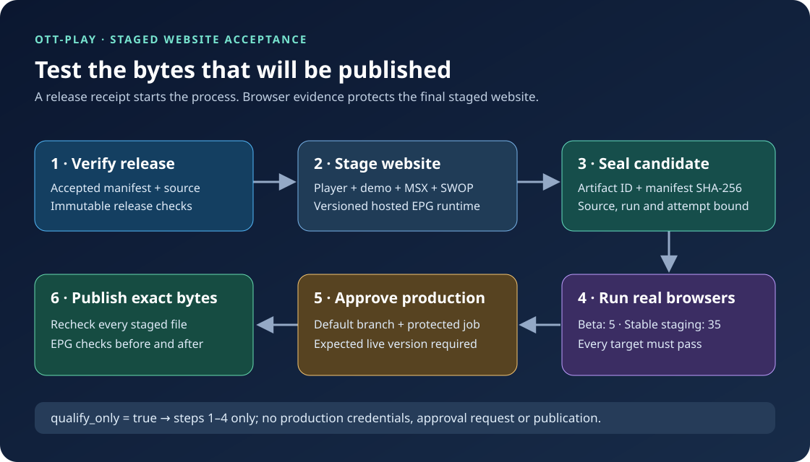
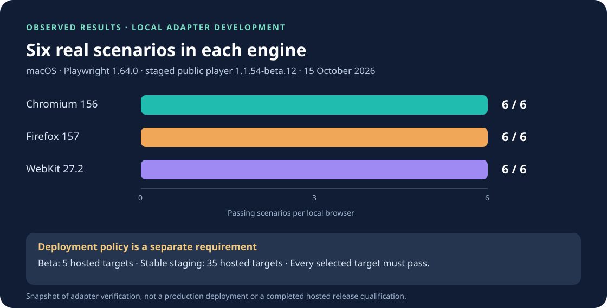

# Browser acceptance of the staged website

The publish workflow verifies the player release and then adds the repository's
hosted configuration, worker graph, MSX entry point and synthetic demo media.
These additions are part of the website users receive. Browser acceptance runs
against that complete staged website, after preparation and before publication.

## Process

1. Verify the independently accepted release manifest and immutable release
   assets using the existing `prepare-dist.py` checks.
2. Stage the final site and seal it as `site.tar.gz` plus `site-manifest.json`.
   The manifest contains every file's SHA-256 and binds the candidate to the
   repository, source SHA, workflow run and attempt.
3. Upload once. The shared browser workflow downloads that exact artifact ID;
   each worker verifies the manifest and every extracted byte before testing.
   Unsafe paths, symbolic links, case collisions, extra files and a candidate
   from another source or attempt are rejected.
4. Require all selected browser targets and the shared aggregate verdict to
   succeed. Beta deployments use five required targets; stable staging uses
   all 35 targets, because the staged site contains additions to the previously
   accepted upstream release. The matrix includes three Playwright generations,
   three operating systems and stable/beta Chrome and Edge channels.
5. The protected production job downloads the same artifact ID and verifies it
   again. Existing default-branch approval, expected live-version comparison and
   EPG checks before/after publication remain required. It does not rebuild or
   restage the site after browser acceptance.

A workflow retry must repeat preparation and qualification together. Artifacts
from a different run attempt deliberately fail verification.

## What the browser adapter checks

The adapter serves only the extracted site on loopback, blocks external browser
requests and uses synthetic inputs. It exercises six real browser scenarios:

- player startup with the staged hosted configuration and visible interface;
- loading the content-addressed hosted EPG worker and diagnostics resources;
- starting the actual staged EPG worker and receiving its close acknowledgement;
- decoding the bundled demo video and observing playback advance;
- rejecting an invalid remote-input pairing link without accessing pairing storage;
- remote-input usability with a mobile viewport and keyboard navigation.

This does not establish compatibility with every television, provider, codec or
live EPG service. The existing independent upstream acceptance and production
EPG guards cover different parts of the release process.

## Run without publishing

Dispatch **Publish here.now** with the accepted tag, manifest SHA-256 and normal
version/channel inputs, and set `qualify_only` to `true`. This mode can qualify
a reviewed branch: it runs preparation and browser acceptance, then skips the
production job entirely. It does not receive the production publishing secret.
The default remains `false`, preserving explicit protected publication.

## Evidence and result scope

Shared browser artifacts record the actual operating system, browser version,
Playwright version, source, run, attempt, candidate artifact ID and six named
scenario results. The aggregate verdict requires the complete selected matrix;
a skipped, failed, missing or mismatched target cannot count as success.

Local adapter development uses an already staged public `1.1.54-beta.12` site.
Its results demonstrate the adapter's behavior on that fixture; they are not a
new release acceptance, a hosted 35-target result or a production deployment.
Current local and hosted results are recorded in the PR and workflow artifacts.

On 15 October 2026, all six scenarios passed locally in Chromium 156.0.8078.4,
Firefox 157.0 and WebKit 27.2 using Playwright 1.64.0 on macOS. The chart is
a dated verification snapshot, not a live CI badge.

The [dated machine-readable snapshot](browser-acceptance-results.json) also
records passing historical Chromium 153 (Playwright 1.63.0) and WebKit 26.5
(Playwright 1.62.1) runs. A local archive round trip preserved all 390 staged
files byte for byte; the current-engine runs used that extracted copy.
